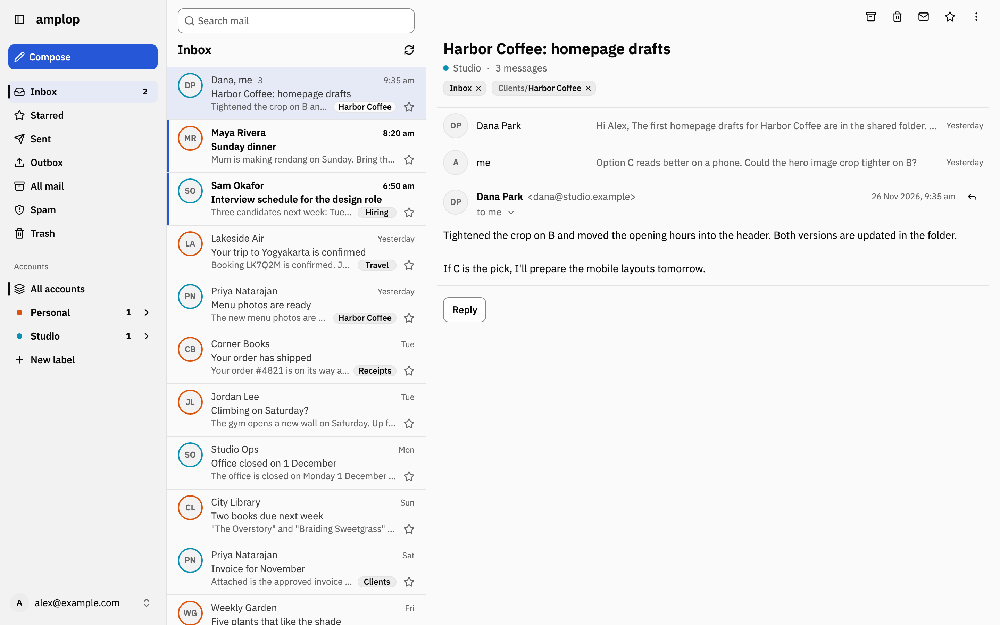

# amplop

A self-hosted webmail client that brings your Gmail accounts into one
inbox, on your own server.

<picture>
  <source media="(prefers-color-scheme: dark)" srcset=".github/screenshots/inbox-dark.png">
  
</picture>

amplop is for someone who runs their own server and wants their mail
accounts in one inbox there, for themselves and the people they invite.
It runs on one machine with Docker Compose.

amplop is in early development: Gmail is its only provider so far, and
there is no release yet, so expect breaking changes before 1.0.

## Features

### Mail

- Connect several Gmail accounts and read them in one unified inbox, or
  one account at a time.
- Conversations grouped by thread, with Gmail's labels as mailboxes.
- amplop cleans each message's HTML and shows it in a sandboxed frame.
  Remote images stay blocked until you allow them; attachments download
  and inline images show without asking.
- Archive, mark read or unread, star, report spam, trash, and add or
  remove labels. An action that takes a conversation out of the list,
  acts on several, or changes labels offers Undo.
- Create, rename, nest, and delete labels.
- Search across every connected account.
- Write new messages, reply, and reply all, from any connected account,
  with an Outbox that shows each message's status and sends a failed one
  again.
- Light and dark themes.

### Accounts and security

- First-administrator setup, guarded by a setup token.
- Registration that an administrator opens or closes; new members join
  through an emailed link.
- Email verification and password reset by emailed link.
- Two-factor sign-in with an authenticator app and backup codes,
  required for administrators.
- A list of your signed-in sessions, where you can end any other one.
- Limits on sign-in attempts and on how fast one client can send
  public write requests.
- Administrators deactivate and reactivate members, and set up and test
  the server's own outgoing email.

### Self-hosting

- One Docker Compose setup that runs everything, with Caddy for HTTPS.
- An upgrade script that keeps the old release running when a new one
  fails to build, migrate, or start ([Upgrades](deploy/README.md#upgrades)
  says what it restores), plus backup, restore, and administrator
  recovery steps.

## Quick start

On a Linux server with Docker, git, and a domain that points at it (see
[What you need](deploy/README.md#what-you-need)):

```sh
git clone https://github.com/akhdanfadh/amplop.git
cd amplop/deploy
cp .env.example .env && chmod 600 .env
# fill in the empty values in .env, except the optional Gmail ones;
# each says how to generate it. Keep a copy of AMPLOP_ENCRYPTION_KEYS
# off the server, e.g. in a password manager.
docker compose up -d --build
```

Then open `https://<your domain>/setup`, enter `AMPLOP_SETUP_TOKEN`, and
create the first administrator. Empty `AMPLOP_SETUP_TOKEN` in `.env` and
run `docker compose up -d` again.

amplop offers Gmail once you add a Google OAuth client of your own, which
[Connecting Gmail](deploy/README.md#connecting-gmail) walks through.
Registration, email verification, and password reset send email: before
you use them, set up the server's outgoing email under Settings, System
email.

The [self-hosting guide](deploy/README.md) covers every step, upgrades,
backups, and using your own proxy instead of Caddy.

## Limitations

- Gmail is the only provider. IMAP and Outlook are not supported yet.
- Connecting an account copies only its recent mail; older mail does not
  appear in amplop's lists or search.
  [Synchronization](backend/README.md#synchronization) says how far back.
- Google restricts the scopes that read Gmail. Each installation uses its
  own Google OAuth client, so members see Google's "Google hasn't verified
  this app" warning when they connect, and Google caps how many accounts
  an unverified installation can connect, as [What Google
  limits](deploy/README.md#what-google-limits) explains.
- Sending is basic: you cannot forward, attach files, or save drafts.
  Closing the compose window, after it asks, discards what you wrote.
- Undo works on a whole conversation: undoing a delete (a move to Trash)
  also moves your own replies in that conversation to the inbox.
- amplop checks accounts for new mail on a schedule instead of receiving
  push notifications.
- amplop does not encrypt mail at rest. Encrypt the disk that holds
  Docker's volumes, as the [self-hosting
  guide](deploy/README.md#message-content) says.

## Roadmap

The [roadmap](https://github.com/users/akhdanfadh/projects/2) shows
what is planned, in order. Each card there is an idea, not a promise.

## How it is built

amplop is a Go server and a React web app, which the server serves,
backed by PostgreSQL, Meilisearch, and an S3-compatible store, and run
with Docker Compose. The [backend](backend/README.md) and [web
app](web/README.md) docs describe each.

### Notable design decisions

Each links to the section that holds the details.

- The server defines the API and enforces every rule itself, so any
  client gets the same behaviour; the web app's client is generated from
  the server's OpenAPI document. See
  [API contract](AGENTS.md#api-contract).
- Your provider stays the source of truth. amplop keeps a synchronized copy
  in a provider-neutral model shaped after JMAP Mail (RFC 8621), and
  changes that copy only after the provider accepts the change. See
  [Synchronized mail](backend/README.md#synchronized-mail) and
  [Conversations](backend/README.md#conversations).
- Each installation uses its own Google OAuth client, so no amplop service
  sits between your server and Google. See [Connecting
  Gmail](deploy/README.md#connecting-gmail).
- Background work runs as DBOS workflows stored in the same PostgreSQL,
  so there is no message broker, and a job saved with a change commits
  with it. See [Background work](backend/README.md#background-work).
- amplop treats every message as untrusted: it sanitizes its HTML and shows
  it in a sandboxed frame with a strict Content-Security-Policy. See
  [Showing HTML](backend/README.md#showing-html).
- The search index can be rebuilt from PostgreSQL and the stored message
  text, so losing it costs only time. See [Search
  index](backend/README.md#search-index).
- Long-lived secrets in the database are hashed or encrypted, and the
  encryption keys stay in your `.env`, off the database. See [Encryption
  keys](backend/README.md#encryption-keys).

## Documentation

- [Self-hosting guide](deploy/README.md): first run, connecting Gmail,
  upgrades, backups, and administrator recovery.
- [Contributing](CONTRIBUTING.md): setting up a development machine,
  checks, and changing the API.
- [Backend](backend/README.md): the Go server, its API conventions,
  configuration, jobs, and storage.
- [Web app](web/README.md) and its [design rules](web/DESIGN.md).
- Every installation serves its API reference at `/api/v0/docs`; see
  [Security headers](backend/README.md#security-headers) for what that
  page loads.

## Contributing

Issues and pull requests are welcome. [CONTRIBUTING.md](CONTRIBUTING.md)
explains the development setup and what a change must pass.

## Security

Please report vulnerabilities privately, as [SECURITY.md](SECURITY.md)
describes, not in a public issue.

## License

amplop is licensed under the [GNU Affero General Public License,
version 3](LICENSE.txt). If you run a modified version for others over a
network, you must offer them its source.

## About

This project was created for learning and portfolio purposes only. It is
not affiliated with any company, client, or organization. All names,
data, and assets used in this project are fictionalized or sanitized for
public use.
